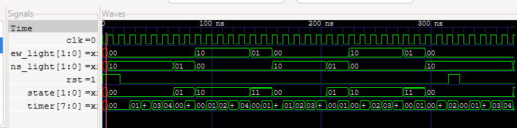

#traffic light controller (verilog fsm)

a two-road traffic light controlller written in verilog as a moore fsm, with a self-checking tester

## design
    4 states, ns green -> ns yellow -> ew green -> ew yellow
    parameterized green/yellow durations (green/yellow ticks)
    unknown states fallback to all-red
    3-block fsm: state reg, next-state logic, output logic

## verification
    testbench checks lights over two cycles, checks that both road are next green simultanously, and a mid-cycle reset, pass/fail grading

## running it
    Requires icarus verilog (gtkwave too)
    iverilog -g2005 -Wall -o sim.out rtl/traffic_light.v
tb/traffic_light_tb.v
    vvp sim.out
    gtkwave traffic_light.vcd